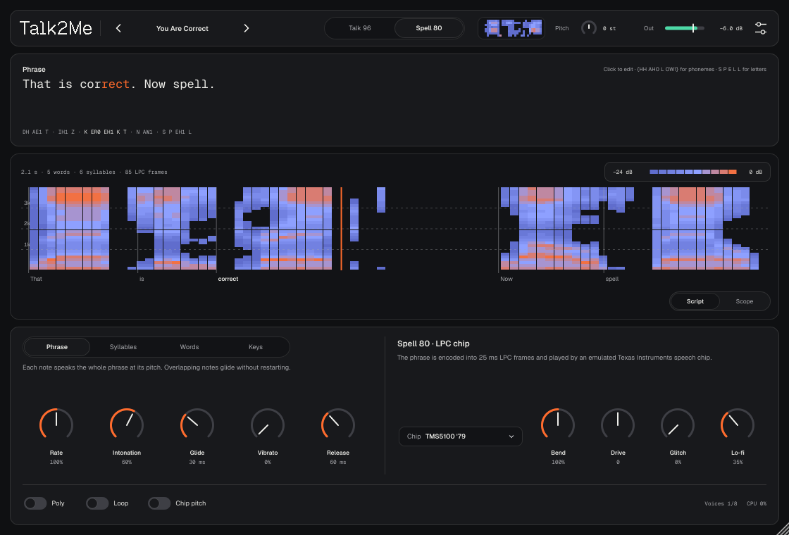
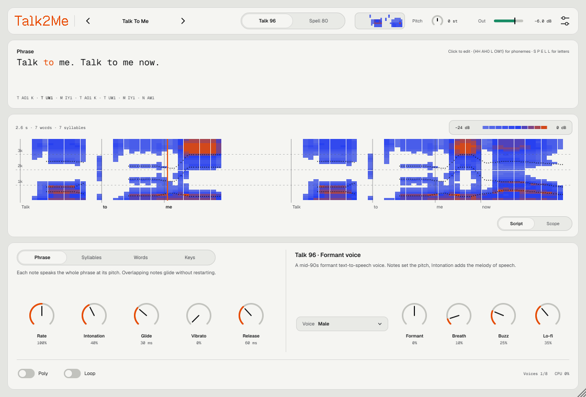

<p align="center">
  
</p>

<p align="center">
  
  
  
  
</p>

<p align="center">
  <a href="https://github.com/controloptioncommand/Talk2me/releases/latest/download/Talk2Me-macOS.zip"><b>⬇ Скачать Talk2Me для macOS</b></a>
</p>

---

**Talk2Me** — вайбкод-плагин: синтезатор речи, который поёт по нотам. Пишете фразу, играете на клавишах — голос произносит её на высоте нажатой ноты. Как talkbox, только вместо рта — синтез речи из прошлого.

Брат [Mist](https://github.com/controloptioncommand/Mist-vst) и [Eido](https://github.com/controloptioncommand/Eido-vst): те же темы Oxygen и Rubber, шрифты Medeo и страница About.

## Два голоса

| Движок | Что это |
|---|---|
| **Talk 96** | Формантный синтез речи в духе программ середины 90-х (тот самый «компьютерный голос» — например, Microsoft Talk It! 1996 года). Каскад резонаторов по Клатту, жужжащий импульсный источник, внутренняя частота 11 025 Гц. Пять голосов: Male, Female, Child, Robot, Whisper. |
| **Spell 80** | Эмуляция чипа синтеза речи Texas Instruments из Speak & Spell. Фраза кодируется в кадры LPC по 25 мс — так TI готовила слова для ПЗУ игрушки — и играется через решётчатый фильтр чипа с его таблицами, интерполяцией, chirp-импульсом и 8-битным ЦАП. Три чипа: **TMS5100 '79** (первый Speak & Spell), **TMC0281D '80** (поздний Speak & Spell и Compact), **TMS5220** (TI-99/4A, аркадные автоматы). |

Честно о сходстве. Talk 96 — не тот же движок, что у Talk It!, а собственный формантный синтез, подогнанный под характер звучания. У Spell 80 таблицы и логика чипа взяты из эмулятора MAME (сверены с декапами и патентами TI), поэтому тембр, «жесть» и артефакты — чиповые. Но слова оригинальной игрушки записывались с живого диктора, а здесь под чипом звучит синтетический голос: можно сказать что угодно, а не только словарь Speak & Spell.

## Как играет

| Режим | Что делает нота |
|---|---|
| **Phrase** | Произносит всю фразу на своей высоте. В моно перекрывающиеся ноты меняют только высоту и не начинают фразу заново — мелодия «едет» по словам, как talkbox. Loop — повтор, пока нота нажата. |
| **Syllables** | Поёт следующий слог и держит его гласную, пока нажата клавиша. Отпустили — слог договаривается. Удобно петь текст по нотам. |
| **Words** | То же, но по словам: держится ударная гласная слова. |
| **Keys** | Каждая клавиша от C3 вверх — своё слово фразы, как в сэмплере. |

Аккорд (ноты в пределах 30 мс) поёт один и тот же слог. Счёт слогов начинается заново при старте воспроизведения в Ableton. Poly — до 8 голосов, у каждого своя копия фразы.

## Ручки

- **Rate** — темп речи 25–300%. **Intonation** — сколько «мелодии речи» добавлять к ноте: 0 — ровно на ноте, больше — ударения и вопросительная интонация. **Glide**, **Vibrato** (и колесо модуляции), **Release**.
- Talk 96: **Voice**, **Formant** (сдвиг формант ±50%), **Breath**, **Buzz** (от мягкого импульса к острому щелчку), **Lo-fi** (8 бит и ступеньки 11 кГц).
- Spell 80: **Chip**, **Bend** (такт чипа 50–200% — классический circuit bending: темп и форманты едут, высота ноты остаётся), **Drive** (перегруз чипа), **Glitch** (переворот битов в кадрах и прыжки по «ПЗУ»), **Lo-fi** (ступеньки ЦАП 8 кГц), **Chip pitch** (высота только целыми периодами, как у железа).
- В тулбаре **Pitch** ±24 полутона и **Out** — громкость (тянуть по шкале).

## Фраза

Клик по фразе — правка на месте, звук меняется сразу, пока печатаете. Английский текст; произношение — по словарю CMUdict (≈126 тыс. слов), незнакомые слова — по правилам чтения.

- Знаки препинания — паузы, «?» — вопросительная интонация.
- Числа читаются словами, годы — как годы: `1996` → nineteen ninety six.
- Одиночные заглавные буквы — названия букв: `S P E L L`.
- Фонемы вручную в фигурных скобках: `{HH AH0 L OW1}` (ARPAbet, цифра — ударение).

Подсвечивается звучащий слог, под текстом — фонемы. Вид **Script** показывает «партитуру» фразы: спектр по кадрам, слова и курсоры звучащих нот. Вид **Scope** — волну на выходе. Мини-спектрограмма в тулбаре — просто для красоты.

<p align="center">
  
</p>

## Пресеты

12 фабричных: Talk To Me, Untrust, You Are Correct, Spell It, Counting, Bent Toy, Arcade, Robot Choir, Whisper, Child Voice, Syllable Singer, Numbers Station. Пресет хранит и фразу, и настройки. Свои — меню пресета → Save preset, лежат в `~/Music/Talk2Me/Presets/*.t2m`.

## Две темы

**Oxygen** — светлая, **Rubber** — тёмная, или по системе: иконка настроек → Appearance. Там же размер окна.

## Установка

1. Скачайте **[Talk2Me-macOS.zip](https://github.com/controloptioncommand/Talk2me/releases/latest/download/Talk2Me-macOS.zip)** и распакуйте.
2. В Терминале:
   ```bash
   bash ~/Downloads/Talk2Me-macOS/install-mac.sh
   ```
   Скрипт кладёт `Talk2Me.vst3` и `Talk2Me.component` в `~/Library/Audio/Plug-Ins` и снимает карантин macOS: плагин подписан ad-hoc, без сертификата Apple.
3. Перезапустите Ableton или Settings → Plug-Ins → Rescan. Talk2Me — инструмент: кладите его на MIDI-дорожку.

В архиве есть папка `demo` с примерами звучания. Подробно о каждой ручке — в **[руководстве](docs/MANUAL.md)**.

Нужен Mac на Apple Silicon и macOS 11 или новее. Каждое изменение в `main` автоматически собирается, проходит pluginval и auval и выкладывается в [Releases](https://github.com/controloptioncommand/Talk2me/releases).

## Сборка

```bash
cmake -B build -DT2M_BUILD_TESTS=ON && cmake --build build --config Release --target Talk2Me_VST3 Talk2Me_AU T2MTest
./build/T2MTest_artefacts/Release/T2MTest ./render
```

JUCE 8 скачивается автоматически. Тест проверяет разбор текста, рендерит ноты во всех режимах, движках и чипах (не тишина, не NaN, не выше 0 dBFS), шаги по слогам и удержание гласной, состояние, все пресеты, скорость, пишет демо-WAV и снимает скриншоты интерфейса.

## Устройство

| Где | Что |
|---|---|
| `Source/Speech/` | Текст → слова → фонемы (CMUdict + правила), слоги, длительности, переходы формант, интонация |
| `Source/DSP/Formant.*` | Формантный синтезатор (Talk 96) |
| `Source/DSP/LpcChip.*`, `ChipTables.h` | Эмуляция TMS51xx / TMS5220 (Spell 80) |
| `Source/DSP/LpcEncoder.*` | Кодирование фразы в кадры LPC чипа |
| `Source/DSP/Engine.*` | Голоса, режимы игры, удержание гласной, пересчёт частоты |
| `Source/UI/` | Интерфейс, темы Oxygen / Rubber, партитура, мини-спектрограмма, About |

Написан на C++ и [JUCE 8](https://juce.com). Чужой код и данные — в [THIRD_PARTY.md](THIRD_PARTY.md).

<p align="center"><sub>made by nnn · vibe-coded with Claude</sub></p>
